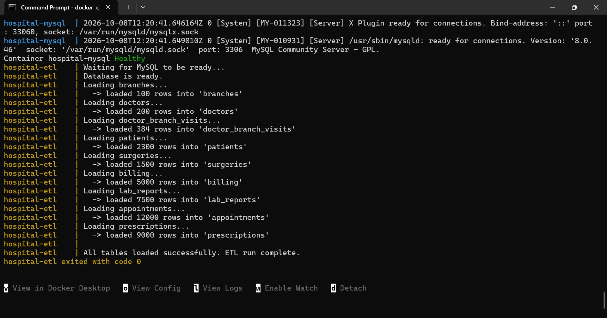
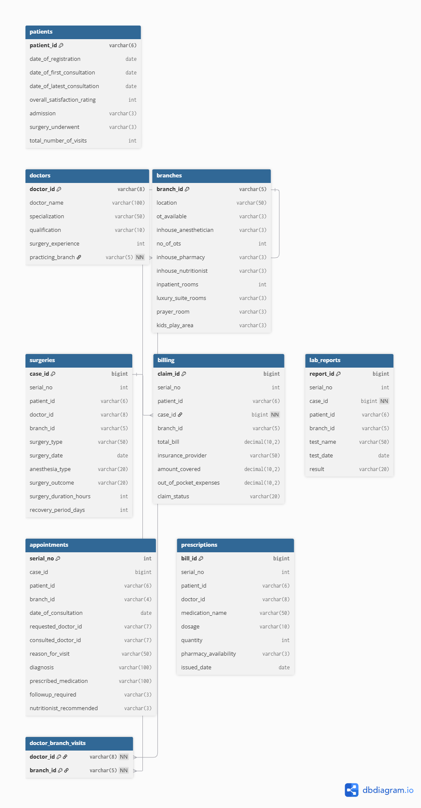

# Cleveland Clinic - Healthcare Data Analytics

*Hospital data engineering project, Docker track*

An ETL pipeline for a multi-branch hospital system. Eight raw CSV files are validated, cleaned and loaded into a relational **MySQL 8.0** database, all in Docker with one command. Three reports (common diagnoses, revenue, patient visits) are then run against the loaded data.

**Stack:** Docker Compose, MySQL 8.0, Python 3.12, pandas, SQLAlchemy

## Quick start

```
cp .env.example .env          # Windows: copy .env.example .env  (then set DB_PASSWORD)
docker compose up --build
```

Place the 8 source CSVs in `ETL/` first (see [Data files](#data-files)). A successful run ends with `All tables loaded successfully. ETL run complete.` and `hospital-etl exited with code 0`.

## How it works

`docker-compose.yml` starts two containers:

| Container | What it does |
|---|---|
| `hospital-mysql` | MySQL database. `schema_complete.sql` is copied into `/docker-entrypoint-initdb.d/`, so the 9 tables and foreign keys are created automatically on first start. |
| `hospital-etl` | Python container. Waits until MySQL is healthy, reads the 8 CSVs, cleans them, loads all tables in dependency order, then exits. |

- The ETL connects to the database by its service name, `mysql`, not `localhost`.
- The password is read from a `.env` file, so it is never written into the code.
- The ETL starts only after MySQL reports healthy. The healthcheck pings over `127.0.0.1`, so it passes only after the schema has finished loading, and it allows up to about 11 minutes for slow machines.
- Data is kept in a named Docker volume (`mysql_data`).

## Project structure

```
.
├── docker-compose.yml
├── .env.example                       # copy to .env and set your password
├── .gitignore
├── reports.sql                        # the 3 report queries
├── MYSQL-INIT/
│   ├── Dockerfile
│   └── schema_complete.sql            # 9 tables, primary and foreign keys
├── ETL/
│   ├── Dockerfile
│   ├── etl_pipeline.py                # extract, transform, load
│   └── requirements.txt
├── evidence/                          # screenshots, ETL log, report output
├── Cleveland_Clinic_annotated.ipynb   # CSV validation notebook with findings
├── db_con_commented.ipynb             # exploratory ETL notebook (local, no Docker)
├── ERD.png                            # entity relationship diagram
└── Runbook_Docker_Track.docx          # full runbook and approach document
```

## Data files

The 8 source CSVs are **not included** in this repository. Before running, place these files in the `ETL/` folder:

`branches.csv`, `doctors.csv`, `surgeries.csv`, `patients.csv`, `billing.csv`, `appointments.csv`, `lab_reports.csv`, `prescriptions.csv`

The Docker build fails if no CSV files are present.

## How to run

**Requirements:** Docker Desktop, running.

1. Create your `.env` file from the template and set a password (letters and numbers only, because special characters such as `@` can break it):
   ```
   DB_PASSWORD=YourPasswordHere
   ```
2. Build and start everything:
   ```
   docker compose up --build
   ```
3. Wait for the final lines:
   ```
   hospital-etl  | All tables loaded successfully. ETL run complete.
   hospital-etl exited with code 0
   ```

The first build takes a few minutes. If port 3306 is already used by a local MySQL, change the port mapping in `docker-compose.yml` to `"3307:3306"`.

## Verify the load

```
docker exec -it hospital-mysql mysql -uroot -p Cleveland_Clinic
```
```sql
SHOW TABLES;
SELECT COUNT(*) FROM patients WHERE future_visit_flag = 1;   -- expect 134
```

| Table | Rows |
|---|---|
| branches | 100 |
| doctors | 200 |
| doctor_branch_visits | 384 |
| patients | 2300 |
| surgeries | 1500 |
| billing | 5000 |
| lab_reports | 7500 |
| appointments | 12000 |
| prescriptions | 9000 |

## Run the reports

```
docker exec -i hospital-mysql mysql -uroot -pYourPasswordHere Cleveland_Clinic < reports.sql > report_output.txt
```

Results from the loaded data:

- **Common diagnoses:** 10 diagnoses, evenly spread. Arthritis is the most common (1260 of 12,000 appointments), followed by Sciatica (1247) and Bronchitis (1240).
- **Revenue:** $128,137,627.30 across 5000 claims, about 59.9% covered by insurance and 40.1% paid out of pocket. Branch CL09 is highest ($13,875,191.88) and SU08 lowest ($11,747,140.15).
- **Patient visits:** roughly 217 to 284 visits per month from January 2020 to December 2023, with no strong trend or seasonality.

## Evidence

The `evidence/` folder holds proof of a successful run:

| File | Shows |
|---|---|
| `01_etl_run.png` | ETL container loading all 9 tables, exit code 0 |
| `02_verify_tables.png` | `SHOW TABLES` and the future-visit flag count inside the MySQL container |
| `03_report_output.png` | The three reports run against the loaded data |
| `etl_run.log` | Full ETL container log |
| `report_output.txt` | Raw output of `reports.sql` |



## Re-running and cleanup

```
docker compose down        # stop and remove containers, keep the database
docker compose down -v     # also wipe the database for a completely fresh run
```

Run `docker compose down -v` before a fresh run. The database lives in a Docker volume, so running `up` again without clearing it makes the ETL insert the same rows twice and fail with duplicate-key errors. The same applies after a run that failed part-way through.

## Data quality findings

All 8 CSVs were validated before the schema was designed (nulls, date formats, duplicates, ID formats, numeric ranges and cross-file referential integrity). Details are in `Cleveland_Clinic_annotated.ipynb`.

| Finding | Decision |
|---|---|
| Patient ID and Doctor ID in the child files almost never exist in `patients.csv` or `doctors.csv` (for example, 100% of Doctor IDs in `prescriptions.csv` are missing from `doctors.csv`). | No foreign keys on these columns. |
| `surgeries`, `billing` and `lab_reports` share a real Case ID. | Foreign keys from `billing` and `lab_reports` to `surgeries`. |
| `doctors.Practicing Branch` matches `branches.csv` exactly (87 of 87). | Foreign key to `branches`. |
| `Other Branches Visited` stores a list as text, which breaks first normal form. | Exploded into a `doctor_branch_visits` junction table. |
| 134 of 2300 patients (5.8%) have a latest-consultation date in the future. | Added a `future_visit_flag` column. Raw values are kept. |
| Requested and Consulted Doctor ID differ in all 12,000 appointments. | Documented as a data-generation artifact. |
| Branch ID `ST100` is 5 characters, the others are 4. | `branch_id` is `VARCHAR(5)` everywhere. |
| All dates are text in `M/D/YYYY`. | Converted with an explicit format so month and day cannot be swapped. |

## Schema

9 tables: `patients`, `doctors`, `branches` (reference), `surgeries`, `billing`, `lab_reports` (linked by Case ID), `appointments`, `prescriptions` (independent) and `doctor_branch_visits` (junction). Foreign keys exist only where validation proved a real relationship. See `MYSQL-INIT/schema_complete.sql`.



## Notes

- `db_con_commented.ipynb` is the exploratory version of the ETL, run directly against a local MySQL. It uses a placeholder password (`YOUR_PASSWORD`); replace it with your own to run it.
- The full runbook, including the issues hit along the way and how they were fixed, is in `Runbook_Docker_Track.docx`.
